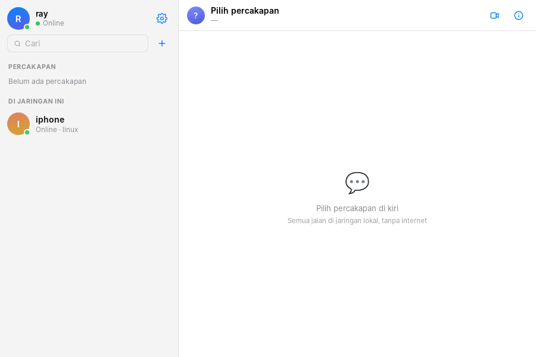
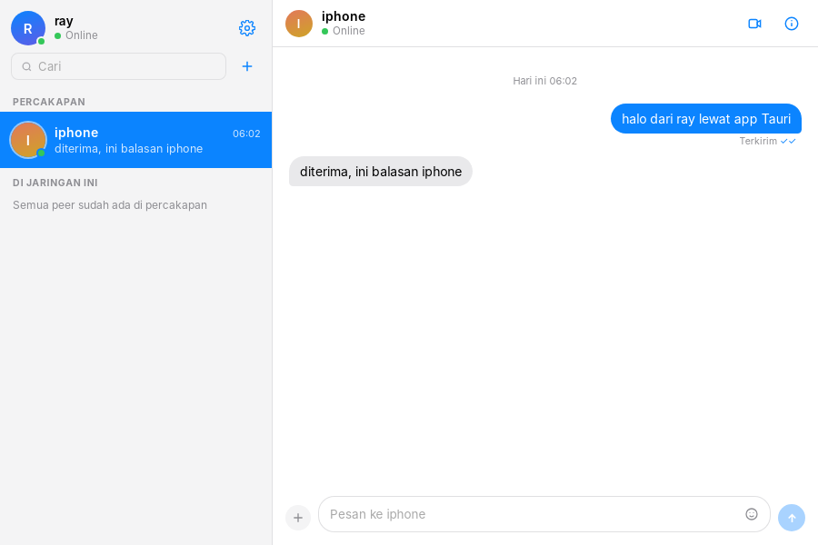
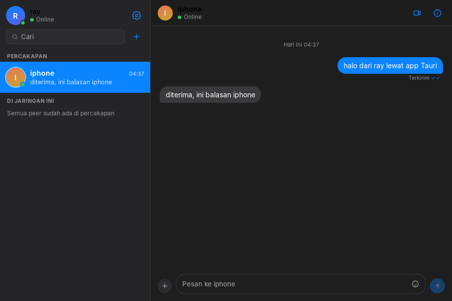

# LAN Chat — iMessage-style, LAN-only, Rust

Chat P2P di jaringan lokal (tanpa server, tanpa internet) untuk **Windows, Linux, Android**.
Tampilan mengikuti iMessage: bubble chat, tema dark/light, status online/idle/DND.

Status: **M0–M3 selesai & teruji** — app desktop Tauri v2 (6,7 MB release), chat dua arah,
grup, kirim file dengan verifikasi sha256. Bukti di `docs/M1-M2-RESULT.md` dan `docs/M3-RESULT.md`.

## Jalanin app desktop

```bash
# butuh dependency Tauri (Debian/Ubuntu):
#   libgtk-3-dev libwebkit2gtk-4.1-dev libsoup-3.0-dev librsvg2-dev build-essential
cargo build -p lanchat-desktop
LANCHAT_NAME=ray LANCHAT_PORT=42101 LANCHAT_DIR=~/.lanchat-ray \
  ./target/debug/lanchat-desktop
```

Dua instance di satu mesin cukup beda `LANCHAT_PORT` + `LANCHAT_DIR`.
Di mesin lain (satu network) pakai port default saja — keduanya otomatis saling menemukan.

## Jalanin CLI (buat debugging core)

```bash
./target/debug/lanchat --name ray --port 42001 --dir ~/.lanchat
```

```
<teks>              broadcast ke semua peer
/dm <id|nama> <txt> chat pribadi
/peers              daftar peer + status koneksi
/ping               info node sendiri
```

Kalau jaringan memblok multicast, tambahkan seed manual: `--seed 10.10.1.28:41234`.

## Fitur yang sudah jalan

| fitur | status |
|---|---|
| Chat 1:1 (DM) | ✅ dua arah, terbukti di app nyata |
| Group chat | ✅ room deterministik dari daftar anggota |
| Broadcast ke semua peer | ✅ |
| Riwayat lokal | ✅ SQLite, persisten antar restart |
| Clear chat | ✅ klik kanan thread → hapus semua pesan |
| Mark read / unread | ✅ badge unread + tanda manual |
| Typing indicator | ✅ (DM) |
| Progress transfer file | ✅ |
| Read receipt (✓✓) | ✅ |
| Status online / idle / DND | ✅ + tersebar real-time ke peer |
| Tema dark / light | ✅ |
| Custom bubble (warna, radius) | ✅ di Pengaturan |
| Zoom teks chat | ✅ `Ctrl + +`, `Ctrl + -`, `Ctrl + 0`, `Ctrl + scroll` |
| Window resize | ✅ bebas (min 720×480) |
| Avatar inisial + status dot | ✅ |
| Emoji picker | ✅ |
| Notifikasi in-app (toast) | ✅ |
| Kirim file (DM, chunked + sha256) | ✅ tombol lampiran / drag & drop |
| Voice / video call | ⬜ M5 |
| Android | ⬜ M4 |

## Struktur

```
crates/core/       lib: proto, identity, discovery, node, store (SQLite)
crates/cli/        harness CLI buat nguji core
apps/desktop/      app Tauri v2 (Rust) + ui/ (HTML/CSS/JS, tanpa framework)
apps/mockup/       mockup statis HTML (arsip, sudah digantikan app nyata)
docs/              PROTOCOL.md, ROADMAP.md, UI-SPEC.md, M0-RESULT.md, M1-M2-RESULT.md
```

UI tidak pakai bundler/framework: `apps/desktop/ui/` berisi 3 file (html/css/js) yang
di-embed ke binary. `preview.html` + `mock-tauri.js` dipakai buat buka UI yang sama di
browser tanpa Tauri (data contoh).

## Test

```bash
cargo test                       # 28 test (21 unit + 7 integrasi dua node nyata)
bash scripts/e2e-m0.sh           # dua instance CLI chat-chatan
bash scripts/e2e-ui.sh           # dua window app desktop, chat + zoom + tema
bash scripts/e2e-file.sh         # transfer file via CLI + verifikasi sha256
bash scripts/e2e-file-ui.sh      # transfer file via dialog GUI asli + sha256
bash scripts/check-zoom.sh       # zoom lewat keyboard, dibuktikan dari SQLite
bash scripts/check-dark.sh       # tema dark persisten antar restart
```

## Keamanan (status jujur)

Masih plaintext: id node berasal dari public key Ed25519, tapi frame belum ditandatangani
dan TLS belum aktif. **Jangan dipakai di jaringan yang tidak dipercaya** sampai TLS +
pinning TOFU + signature per pesan selesai. Ini pekerjaan M1-lanjut yang belum dikerjakan.

## Catatan platform

- **Windows**: butuh WebView2 runtime (Windows 11 sudah ada). Firewall akan minta izin saat
  pertama listen — wajib diizinkan, kalau tidak peer tidak bisa connect.
- **Linux**: butuh `libwebkit2gtk-4.1`. Di X11 tanpa compositor, window bisa tampak abu-abu
  saat tidak fokus (xfwm4 `inactive_opacity`), bukan bug app.
- **Android**: belum dibangun; wajib `MulticastLock` + izin `NEARBY_WIFI_DEVICES` untuk discovery.
- **WiFi kampus/kantor**: AP/client isolation memblok P2P sepenuhnya — tidak bisa diakali dari app.

## Screenshot (dari app nyata, bukan mockup)



